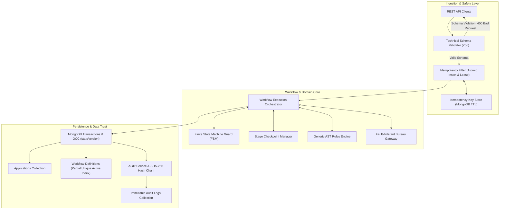
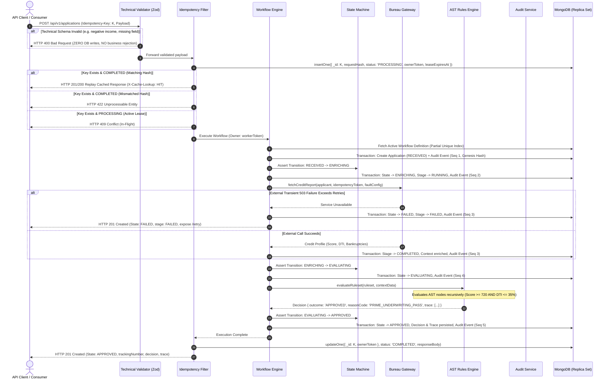
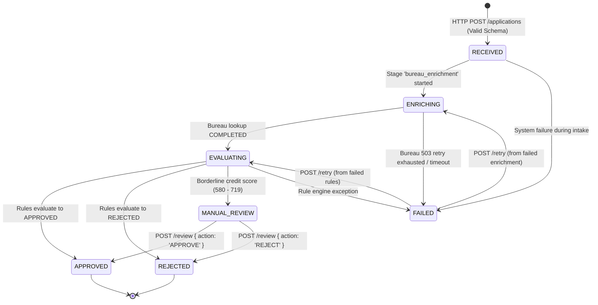

# DecisionFlow: Architecture & Technical Specification

## 1. Executive Summary

DecisionFlow is a configurable, resilient workflow decision platform built in **Node.js, Express, MongoDB, and Zod**. It executes multi-stage business workflows, evaluates pure in-memory dynamic AST rules, coordinates finite state transitions, isolates external dependencies with fault injection and external idempotency, and records tamper-evident, cryptographically chained audit trails.

The demonstration use case is a **Retail Loan Underwriting Platform** supporting `APPROVED`, `REJECTED`, and `MANUAL_REVIEW` outcomes. Crucially, the core engines contain **zero loan-specific terms or hardcoding**. All workflows, stages, rules, and decision policies are declared via versioned configuration schemas.

---

## 2. System Architecture & Component Boundaries

DecisionFlow follows a **Modular Monolith** architecture with strict hexagonal layer boundaries:

### Module Responsibilities

| Module | Responsibility | Isolation Guarantee |
| :--- | :--- | :--- |
| **TechnicalValidator** | Validates incoming JSON syntax and data types via Zod schemas. | Returns `HTTP 400 Bad Request` directly. Never evaluates business eligibility or writes to the database. |
| **IdempotencyManager** | Unique-key insertion, SHA-256 payload hashing, lease ownership (`ownerToken`), active lease protection (`HTTP 409`), expired lease reclamation, and cached response replay (`HTTP 200` with `X-Cache-Lookup: HIT`). | Stale workers whose lease expired cannot overwrite newer results. |
| **WorkflowEngine** | Coordinates execution across stages, checks persisted stage checkpoints, resumes after failures without repeating completed side-effects. | Pure orchestrator; delegates domain logic to RulesEngine and StateMachine. |
| **RulesEngine** | Evaluates recursive AST rules (`AND`, `OR`, single-child `NOT`, threshold comparisons) against arbitrary JSON. Computes deterministic priority, ties, and explainable trace trees. | **Pure, stateless in-memory function.** Zero DB dependencies, zero business-specific hardcoding. |
| **StateMachine** | Strictly guards lifecycle states (`RECEIVED`, `ENRICHING`, `EVALUATING`, `APPROVED`, `REJECTED`, `MANUAL_REVIEW`, `FAILED`) and terminal states (`APPROVED`, `REJECTED`). | Throws `InvalidStateTransitionError` (`HTTP 409`) on illegal transitions. |
| **CheckpointManager** | Tracks stage lifecycle (`PENDING`, `RUNNING`, `COMPLETED`, `FAILED`) and stores stage outputs and error details. | Enables resumption without re-calling completed external APIs. |
| **BureauGateway** | Simulates third-party Credit Bureau lookups with configurable latency, transient 503s, and exponential backoff with full jitter. | Features an in-memory/persisted external idempotency store to prevent duplicate billing on retry. |
| **AuditService** | Canonicalizes event records (RFC 8785) and builds a SHA-256 cryptographic hash-chain (`previousHash` $\to$ `eventHash`). | Provides `verifyAuditChain` endpoint to detect tampering or gaps. |

---

## 3. Request-to-Decision Data Flow

---

## 4. Finite State Machine (FSM)

---

## 5. Generic AST Rules Engine Semantics

1. **Deterministic Ordering**: Rules specify integer `priority` (1 = highest priority). Equal-priority ties are resolved deterministically by lexicographical ASCII sort on `ruleId`.
2. **Configurable Mandatory Failure**: Mandatory rules (`isMandatory: true`) evaluate first. If a mandatory condition fails, the engine applies that rule's configured `failureOutcome` (e.g. `{ outcome: 'REJECTED', reasonCode: 'SANCTIONS_COMPLIANCE_BLOCK' }`), avoiding hardcoded rejections.
3. **Trace Tree Transparency**: The trace tree documents the disposition of **every rule in the ruleset**:
   - Evaluated before match: `status: 'EVALUATED_UNMET'` with condition tree breakdown.
   - Winning rule: `status: 'MATCHED'` with condition tree breakdown and action metadata.
   - Evaluated after match under `FIRST_MATCH`: `status: 'NOT_EVALUATED'` with `reason: 'Short-circuited by higher-priority match [RULE_ID]'`.
4. **NOT Condition Guard**: Schema strictly enforces that `combinator === 'NOT'` has **exactly 1 child condition**.
5. **ReDoS Elimination**: `MATCHES_REGEX` is deferred from the MVP to eliminate Regular Expression Denial of Service risks without native C++ compilation bindings.

---

## 6. Cryptographic Audit Trail (SHA-256 Hash Chain)

Every audit record in `audit_logs` is cryptographically chained to its predecessor:
- `sequenceNumber`: Monotonically increasing per application (1, 2, 3...)
- `previousHash`: Hash of the previous event (Genesis event uses 64 zeros)
- `canonicalData`: Deterministic JSON serialization according to RFC 8785 (keys sorted alphabetically)
- `eventHash`: `SHA256(previousHash + canonicalData)`

### Trust Boundary
- **Guaranteed**: Detects out-of-order execution, dropped events, payload tampering, and application-level bugs via `GET /api/v1/applications/:id/audit/verify`.
- **Known Limitation**: Because hashes reside in MongoDB, an administrator with direct root database write access could theoretically alter historical records and recompute downstream hashes. Anchoring block hashes to an external WORM ledger or HSM timestamp is deferred to future iterations.

---

## 7. Engineering Trade-offs & Scope Control (<24h Constraint)

| Dimension | MVP Implementation Choice | Production Enterprise Scale | Justification for Hackathon (<24h) |
| :--- | :--- | :--- | :--- |
| **Execution Model** | **Synchronous Request-Driven Pipeline** | Asynchronous Distributed Queue (BullMQ / Kafka) | Synchronous execution provides instant REST feedback without external queue dependencies (Redis). Steps are cleanly decoupled so they can be wrapped in a worker later. |
| **Rules Engine** | **Custom In-Memory AST Interpreter** | External Business Rules Engine (Drools / Goja) | Custom AST interpreter in pure JavaScript yields 100% test coverage, sub-millisecond execution, complete explainability trace trees, and zero external engine dependencies. |
| **Transactions & Testing** | **MongoDB Transactions + MongoMemoryReplSet** | Multi-Region Sharded Replica Sets | `MongoMemoryReplSet` runs a single-node replica set in memory during Jest test runs, enabling 100% native multi-document ACID transactions with zero local installation prerequisites. |
| **External Dependency** | **In-Process Gateway with Fault Injection** | Standalone WireMock Microservice | In-process mock gateway supports deterministic fault injection (503s, timeouts, rate limits) without port collisions or flaky network calls during automated test suites. |

